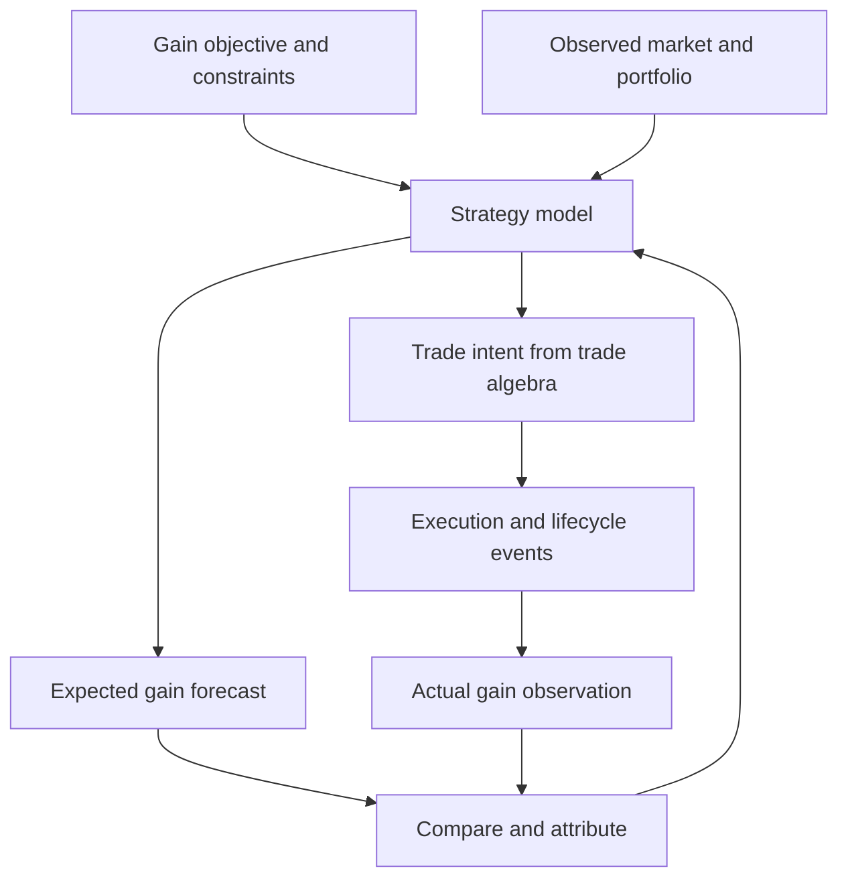

# Commodities P&L, Risk, Trade Algebra and Strategy Gain Vectors

- **Date:** 24 October 2026
- **Participants:** Dimitar Popov and ChatGPT
- **Project:** Constraints Ontology
- **Record type:** Conversation transcript

> This transcript preserves the user messages and assistant replies supplied in the conversation, including the assistant's progress messages and the subsequent request to save the discussion. Split message fragments have been rejoined. Mathematical delimiters have been adapted for GitHub Markdown, and a descriptive label has been added to the originally unlabelled document link. The discussion is archived as given; this export does not revise or independently validate its claims.

## 1. How commodities P&L works

### User

Explain how pnl works for commodities trading

### Assistant — progress

I’ll explain it from a trading desk’s perspective, with a simple oil example showing how P&L changes over time.

### Assistant

**Commodities P&L—profit and loss—measures what a trading business has earned or lost from its trades, including changes in the value of positions it still holds.** The key is that profit can change before anything is delivered or paid for.

For a trading desk, there are three questions: **What are our positions worth? How much did that value change today? What caused the change?**

### 1. Start with a simple trade

Suppose you buy **100,000 barrels of oil at $75 a barrel**. All figures below are USD.

If the relevant market price rises to $78:

$$
\text{Profit} = 100{,}000 \times (78-75) = \$300{,}000
$$

You have made a **$300,000 mark-to-market gain**: your position is worth more, even though you haven’t sold it.

If you subsequently sell at $79, your total trading profit is $400,000 before costs. You recognise only another $100,000 beyond the $300,000 already recorded.

| Event | P&L for the period | Cumulative P&L |
|---|---:|---:|
| Buy at $75 | $0 | $0 |
| Market rises to $78 | +$300,000 | +$300,000 |
| Sell at $79 | +$100,000 | +$400,000 |

This illustrates the distinction between **daily P&L** and **profit since the trade began**.

For exchange-traded futures, mark-to-market gains and losses are generally settled in cash daily, so an open position can already have generated cash receipts or payments. ([cmegroup.com](https://www.cmegroup.com/clearing/files/CME-Money-Calculations-Futures-and-Options.pdf?utm_source=chatgpt.com))

### 2. Physical trading adds costs and logistics

A physical trader might buy oil in one location, transport it and sell it elsewhere.

| Item | Amount |
|---|---:|
| Sell 100,000 barrels at $79 | +$7,900,000 |
| Purchase at $75 | −$7,500,000 |
| Freight | −$150,000 |
| Storage and insurance | −$30,000 |
| Financing | −$20,000 |
| **Net trading profit** | **$200,000** |

The apparent $4-per-barrel margin becomes **$2 per barrel after costs**.

Delays, quality differences, lost quantities and changes in freight costs can all change that result.

### 3. Hedges change where the P&L comes from

A trader holding oil may sell futures to protect against falling prices.

Assume the physical oil and hedge move by exactly the same amount:

| Price movement | Physical oil P&L | Short futures P&L | Combined |
|---|---:|---:|---:|
| Oil rises $3/barrel | +$300,000 | −$300,000 | $0 |
| Oil falls $3/barrel | −$300,000 | +$300,000 | $0 |

**A loss on the hedge can be evidence that the hedge is working.** You assess it alongside the exposure it protects.

In practice, they rarely offset perfectly. The physical oil might have a different location, quality or delivery date from the futures contract. That mismatch is called **basis risk**.

### 4. There is no single “oil price”

A commodity position has several dimensions:

| Dimension | Example | Potential P&L driver |
|---|---|---|
| Commodity | Crude oil versus refined diesel | Refining spread |
| Location | Gas in the US versus Europe | Regional price difference |
| Delivery date | Oil delivered in December versus March | Calendar spread |
| Quality | Different grades of crude | Quality premium or discount |
| Currency | USD commodity, AUD reporting | Exchange-rate movement |
| Optionality | Right to buy at a fixed price | Price, volatility and time |

For future delivery, valuation generally uses the **relevant forward price**, rather than simply today’s spot price. Options require additional modelling.

### 5. How a bank desk calculates daily P&L

A useful economic identity is:

$$
\text{Daily P&L}
=
\text{Closing position value}
-
\text{Opening position value}
+
\text{Net trade cash flows}
$$

Here, cash received is positive and cash paid is negative; funding transfers and collateral need separate treatment.

The desk then produces a **P&L explain**—a breakdown of why the result changed:

| Explanation | Meaning |
|---|---|
| Market movements | Commodity curves, basis, FX or volatility changed |
| New trades | Value earned or lost from today’s transactions |
| Time passing | Accruals, option decay and contracts approaching delivery |
| Costs | Funding, brokerage, freight, storage |
| Adjustments | Trade corrections, valuation reserves or model changes |
| Unexplained | Difference between actual P&L and the attributed movements |

For example: “The desk made $1.2 million: $900,000 from gas prices, $400,000 from regional spreads, less $100,000 of costs.”

That explains performance much better than the total alone.

### 6. Why different P&L reports can disagree

**Economic P&L, accounting P&L and cash flow measure different things.**

- **Economic P&L:** how the value of the combined trading activity changed.
- **Accounting P&L:** what accounting rules recognise in that period.
- **Cash flow:** what was actually received or paid.

Recognition and valuation differences can temporarily separate accounting results from the economics. For example, BP describes trading inventory valued using spot prices while related derivatives use forward prices matching their maturities. ([sec.gov](https://www.sec.gov/Archives/edgar/data/313807/000031380725000026/bp-20250630.htm?utm_source=chatgpt.com))

For a commodities desk, the central task is therefore **valuing the whole book—physical trades, derivatives and costs—and explaining how its value changed across prices, locations, delivery dates and currencies.**

## 2. Risk versus P&L

### User

Whats the difference between risk and pnl

### Assistant

**P&L tells you how much you have made or lost. Risk tells you how much you could make or lose from the positions you currently hold.**

Using the oil example:

| | P&L | Risk |
|---|---|---|
| Question | “What have we earned or lost?” | “What happens if the market moves?” |
| Buy 100,000 barrels at $75; price now $78 | **+$300,000** so far | Each **$1 fall** costs you **$100,000** while you hold it |
| Sell the entire position at $78 | Profit remains **+$300,000**, before costs | Oil-price exposure falls to **zero**, assuming no other obligations |

**P&L measures an outcome; risk measures exposure to possible outcomes.** You can have a profitable position that is extremely risky, or a losing position with very little remaining risk.

For a commodities desk, risk typically includes:

- **Price risk:** oil, gas or metals prices move.
- **Basis risk:** the physical commodity and its hedge move differently.
- **Volatility risk:** changing volatility affects options.
- **Credit risk:** a counterparty fails to pay or deliver.
- **Liquidity risk:** a position is expensive or difficult to exit.
- **Operational risk:** shipping delays, incorrect trades or failed delivery.

The link between them is **P&L explain**: yesterday’s exposures, combined with today’s market moves, help explain today’s profit or loss.

For example: **“Yesterday we had exposure of $100,000 per $1 move in oil. Oil rose $3 today, so we earned approximately $300,000.”**

## 3. Position paths, dates and values

### User

I'm an engineer trying to understand this and have been asked to create reports around position path that aligns with the full curve name, position date that aligns with the curve tenors, position value

### Assistant

In engineering terms, you’re probably being asked to report a **position as a vector indexed by a market curve and its delivery dates**.

A curve is a set of prices for the same market at different future dates. For example, a gas curve could contain a November price, a December price, a January price, and so on.

Your three fields likely map like this:

| Requested field | Likely meaning | Illustrative example |
|---|---|---|
| **Position path** | Identifies the market curve the exposure belongs to; aligns with its full curve name | `Gas / Europe / TTF / EUR / MWh` |
| **Position date** | Identifies the delivery period or tenor along that curve | December 2026 |
| **Position value** | Amount of position or exposure allocated to that curve and tenor | +10,000 MWh |

**The important ambiguity is “position value”: it may mean quantity, monetary market value, or sensitivity. Those are different measures.** Your field names alone don’t establish which one.

### Picture the report as a matrix

Suppose the position measure is signed physical quantity:

| Position path / full curve name | Nov 2026 | Dec 2026 | Jan 2027 |
|---|---:|---:|---:|
| TTF gas, EUR/MWh | +10,000 | +15,000 | −5,000 |
| Henry Hub gas, USD/MMBtu | −20,000 | +8,000 | 0 |

Each cell means: **“For this market and delivery period, how much exposure do we hold?”**

Positive commonly means long and negative means short, but confirm your system’s sign convention. You also cannot meaningfully add the two rows without addressing their different units.

The underlying rows would look like:

```text
as_of       curve_name             position_date  measure   unit  value
2026-10-24  Gas.Europe.TTF.EUR.MWh  2026-12-01     quantity  MWh   15000
```

Here, **`as_of` and `position_date` are separate dimensions**:

- `as_of`: when we measured the position.
- `position_date`: when the commodity is delivered or the exposure applies.

A December position can therefore appear in reports produced every day throughout October.

### How this connects to risk and P&L

Suppose you hold **10,000 MWh for December** and the December curve price rises from **€40/MWh to €42/MWh**.

For a simple linear position:

$$
\Delta \text{P&L} \approx 10{,}000\ \text{MWh} \times 2\ \text{€/MWh}
= €20{,}000
$$

The mapping is:

| Element | Role |
|---|---|
| Position path | Select the correct curve |
| Position date | Select the correct point or bucket on that curve |
| Position value | Supply the quantity or sensitivity |
| Change in curve price | Supply the market movement |
| Their product | Estimate the resulting P&L |

That makes your report likely a **position/exposure report feeding risk and P&L calculations**, rather than a P&L report itself.

### What to pin down before implementing

Ask the report owner these four concrete questions:

1. **What does position value measure, and in what units?** Quantity, market value, or delta/sensitivity?
2. **Is position date an exact delivery date or a tenor bucket?** For example, does `2026-12-01` mean that day or the whole month?
3. **Is position path the actual curve identifier or a hierarchy that maps to one?** Prefer a stable curve ID behind the display name.
4. **What is the row grain?** One row per snapshot × book × curve × tenor × measure, or are trades and other dimensions retained?

For quarterly or yearly trades, you’ll also need the desk’s rule for allocating exposure into monthly or daily buckets. **Matching names and dates is only reliable once the measure, units and tenor allocation rules are defined.**

## 4. A universal algebra and calculus across trading desks

### User

We have over 60 trading desks across many businesses, Im looking for a univerals algebra and calculus to tie it togehter

### Assistant — progress

I’ll frame this as a common mathematical model for positions, valuation, risk and P&L, and check how established risk frameworks handle the same problem across asset classes.

### Assistant

**Yes—there is a useful common mathematical structure: portfolios compose algebraically, valuation maps them to money, risk describes how valuation responds to change, and P&L measures the change that occurred.**

For your 60 desks, I would standardise those objects and operations, while allowing each business to supply its own valuation models. The following is a proposed engineering foundation.

**Start with one valuation function:**

$$
\boxed{V(P,x,t;\mathcal M)}
$$

| Symbol | Meaning |
|---|---|
| $P$ | Portfolio state: contracts, quantities, remaining obligations |
| $x$ | Market state: commodity prices, rates, FX, volatility, etc. |
| $t$ | Valuation time |
| $\mathcal M$ | Models and conventions used |
| $V$ | Value in a specified reporting currency |

An oil desk, gas desk and options desk implement different valuation functions, but expose the same interface.

Your position report is then one **projection** of this richer model.

**The algebra comes from combining portfolios.**

Let $P_A \oplus P_B$ mean “combine the positions of portfolios A and B.” This operation is associative, commutative and has an empty portfolio as its identity—a **commutative monoid**.

For additive trade valuations, evaluated consistently:

$$
V(P_A\oplus P_B)=V(P_A)+V(P_B)
$$

Consequently:

$$
\nabla_x V(P_A\oplus P_B)
=
\nabla_x V(P_A)+\nabla_x V(P_B)
$$

That gives you a powerful implementation property: **you can calculate trade-level values and sensitivities, then aggregate them through books, desks and businesses.**

An option can be nonlinear in market prices while its value remains additive with other trades. These are different dimensions of linearity.

Portfolio effects—such as counterparty netting or shared operational constraints—need an explicit calculation scope. A useful extension is:

$$
V(P)=\sum_{i\in P}V_i+A(P)
$$

where $A(P)$ contains adjustments or interactions calculated at the appropriate portfolio or netting-set level.

**The shared coordinate system is the set of risk factors.**

Generalise your existing fields this way:

| Existing field | Generalised meaning |
|---|---|
| Position path | Identity of the market object: curve, surface, spot quote, etc. |
| Position date | Coordinate within that object: delivery period, maturity, expiry, etc. |
| Position value | A typed measure attached to that coordinate |

For example:

```text
Market object: Brent forward curve
Coordinate:    December 2026 delivery
Market value:  78 USD/barrel

Measure:       Price delta
Measure value: 10,000 USD per (USD/barrel)
```

The market price and the position sensitivity share a coordinate, but have different types and units.

For a volatility surface, the coordinate might include **expiry and strike**. For power, it might include **delivery period and peak/off-peak profile**. So a single date is sufficient for some reports, but not for the universal model.

This separation already appears in OpenGamma Strata’s sensitivity format: curve reference, sensitivity type, tenor/date, currency and value. Basel’s market-risk framework likewise organises sensitivities around defined risk factors. ([strata.opengamma.io](https://strata.opengamma.io/sensitivity_loader/?utm_source=chatgpt.com), [bis.org](https://www.bis.org/committees/bcbs/basel-framework/standard/mar/21/inforce/2023-01-01/published/2024-07-05?utm_source=chatgpt.com))

**The calculus connects those coordinates to risk and P&L.**

For a fixed portfolio, define:

$$
r_i=\frac{\partial V}{\partial x_i},
\qquad
H_{ij}=\frac{\partial^2 V}{\partial x_i\partial x_j}
$$

- $r$ is the vector of first-order sensitivities: how value responds to each market factor.
- $H$ captures curvature and interactions between factors.

For small market movements:

$$
\boxed{
\Delta V
\approx
r^\top\Delta x
+
\frac12\Delta x^\top H\Delta x
+
\frac{\partial V}{\partial t}\Delta t
}
$$

In engineering terms, **risk is the local response function; market movement is its input; estimated P&L is its output.**

The first term works across businesses:

| Exposure | Sensitivity × market movement |
|---|---|
| Oil price | USD per USD/barrel × change in USD/barrel |
| Interest rate | USD per basis point × change in basis points |
| FX | USD per exchange-rate unit × exchange-rate change |
| Volatility | USD per volatility point × volatility-point change |

Each product produces money, provided units and scaling agree.

For large moves or discontinuous payoffs, use full scenario revaluation:

$$
\Delta V_s=V(P,x_s,t)-V(P,x_0,t)
$$

This remains usable even where a derivative approximation performs poorly.

**The most important operation across desks is a change of coordinates.**

Different desks may express exposure using different curves, tenors, spreads or calibrated parameters.

Suppose a desk’s native market coordinates are $x$, and your common coordinates are $z$, with:

$$
x=f(z)
$$

The chain rule gives:

$$
\boxed{r_z=J_f^\top r_x}
$$

Here $J_f$ describes how native market factors change when the common factors change.

This is the mathematical basis for converting sensitivities between representations. OpenGamma explicitly uses calibration Jacobians to transform curve-parameter sensitivities into market-quote sensitivities. ([opengamma.com](https://opengamma.com/strata-and-multi-curve-calibration-and-bucketed-pv01/?utm_source=chatgpt.com))

The critical invariant is:

$$
r_x^\top\Delta x=r_z^\top\Delta z
$$

for movements represented by that mapping, to first order.

**Changing representation should preserve the P&L response to the same economic scenario.** That is a much stronger requirement than matching curve names or distributing quantities across dates.

A coarse mapping can lose information. For example:

| Delivery | Oil exposure | Price movement | P&L |
|---|---:|---:|---:|
| January | +10,000 barrels | +$2/barrel | +$20,000 |
| February | −10,000 barrels | +$1/barrel | −$10,000 |
| **Total** | **0 barrels** | | **+$10,000** |

Summing quantity gives zero, but the calendar-spread exposure remains. Your common representation must retain the coordinates needed to express it.

**Actual P&L also needs a lifecycle and cash-flow ledger.**

Between two reporting times:

$$
\boxed{
\Pi_{0\rightarrow1}
=
V(P_1,x_1,t_1)
-
V(P_0,x_0,t_0)
+
C_{0\rightarrow1}
}
$$

Here $V$ excludes cash already counted in $C$, and $C$ is net cash received from the positions and trading activity, including applicable costs. External capital transfers are excluded; currency conversion must be consistent.

This accommodates new trades, settlements, deliveries and expiries. It also prevents settlement from appearing to destroy value simply because a receivable disappears from the open-position valuation.

A P&L explain decomposes this total into market movement, time passage, trading activity, lifecycle events and adjustments. **That decomposition needs an explicit attribution convention:** nonlinear interactions can be assigned differently depending on the order in which you apply changes.

**For implementation, I would make every reported measure carry this contract:**

| Component | Required meaning |
|---|---|
| Scope | Trade, book, desk, business or netting set |
| Snapshot | Valuation time and position-state version |
| Market coordinate | Canonical market-object ID plus typed coordinates |
| Measure | Quantity, PV, delta, gamma, vega, scenario P&L, etc. |
| Units | Currency, physical unit and sensitivity scaling |
| Basis | Market snapshot, model version and mapping version |
| Aggregation rule | Sum, recalculate, or allocate from a parent scope |
| Lineage | Source positions and transformations |

For gamma and other cross-sensitivities, the measure references **two market coordinates**.

This makes `position_value` a typed value rather than an ambiguous number. ISDA’s Common Risk Interchange Format is an existing reference for exchanging risk measures, although your internal model would need additional lifecycle and provenance information. ([isda.org](https://www.isda.org/isda-solutions-infohub/common-risk-interchange-format/?utm_source=chatgpt.com))

One boundary matters: **sensitivities and scenario P&Ls can aggregate under consistent assumptions; VaR, expected shortfall, margin and capital generally cannot be obtained by summing desk totals.** Aggregate the underlying scenario results or exposures, then apply the relevant calculation.

I would make your central acceptance test: **“When two desks describe the same economic exposure, do their normalised representations produce the same value change under the same scenario?”** That turns the universal algebra into something you can verify.

## 5. Trade models, strategy models and gain vectors

### User

I want to tie this to a trade algebra that defines trade models and a trading strategy model that defines strategies against my gain vector

### Assistant — progress

I’ll connect trade definitions, portfolio valuation and strategy decisions in one typed model. I’ll also use the Personal Context skill to check whether you’ve already defined the gain vector, so I preserve its meaning.

### Assistant — progress

I found your earlier definition: the gain vector represents an expected or realised economic transformation, with an explicitly declared basis. I’m using the Library skill to check the underlying trade-continuum document before extending that model.

### Assistant — progress

Your existing document already defines the strategy-to-trade continuum. The useful next step is to make its laws precise: how contracts compose, how strategies generate intents, and how expected and actual gain are compared. One point needs tightening: an executed exposure vector must be converted into a gain forecast before it can be compared numerically with expected monetary gain.

### Assistant

**Yes. I would express this as one typed algebra in which trade models define possible contractual actions, strategy models choose actions, and your gain vector measures their intended and actual economic effects.**

This connects directly to your existing [trade-continuum document](https://chatgpt.com/library?file_id=libfile_9b3e57e70828819196f1c2a603bdac1e&account_id=personal). That document already establishes strategy → intent → execution → CDM lifecycle → gain. The next step is to give those relationships precise composition laws.

The central model would be:

| Object | Defines |
|---|---|
| **Trade model** | Which obligations, rights and lifecycle transitions a contract creates |
| **Strategy model** | How observations, objectives and constraints produce trade intents |
| **Gain model** | How resulting economic changes are measured in a declared basis |
| **Interpretation** | How those objects produce valuations, risk, P&L and reports |

These belong to one **many-sorted algebra**: one coherent system with distinct types and valid operations between them.

**Trade models should be composable expressions.**

A small set of constructors can express a broad family of contracts:

| Constructor | Meaning |
|---|---|
| `Transfer(asset, quantity, parties)` | An obligation to transfer money or an asset |
| `At(date, contract)` | Schedule an obligation |
| `Both(a, b)` | Combine contractual legs |
| `Scale(quantity, contract)` | Scale the contractual quantities |
| `Observe(index, rule)` | Determine an amount using a specified observation |
| `Choose(holder, window, alternatives)` | Give a party an exercise right |

For example, a simplified commodity swap consists of two scheduled legs:

```text
CommoditySwap(quantity, index, fixedPrice, schedule)
  = Both(
      ReceiveFloating(quantity, index, schedule),
      PayFixed(quantity, fixedPrice, schedule)
    )
```

`CommoditySwap` is a reusable **trade model**. An agreed instance adds counterparties, quantities, prices and other terms. Its **trade state** records what has happened and which obligations remain.

This approach has established foundations in the financial-contract combinator work of Peyton Jones, Eber and Seward. ([microsoft.com](https://www.microsoft.com/en-us/research/publication/composing-contracts-an-adventure-in-financial-engineering/?utm_source=chatgpt.com))

Lifecycle events then act on state:

```text
ApplyEvent : TradeState × Event
          → Either<Violation, TradeState>
```

CDM provides a compatible foundation: its event model defines composable state transitions with before/after states and lineage. ([cdm.finos.org](https://cdm.finos.org/docs/event-model?utm_source=chatgpt.com))

**Your gain vector becomes an interpretation of an economic transition.**

Retain your existing invariant:

$$
\boxed{\text{No gain vector without a declared basis}}
$$

I would formalise gain observation as:

$$
G_B(\tau;\kappa)
$$

where:

- $B$ is the declared basis.
- $\tau$ is the observed or simulated trajectory: trades, cash flows, market changes and lifecycle events.
- $\kappa$ contains the reference baseline, horizon, units, valuation conventions and attribution method.

Using a trajectory accommodates strategies involving rebalancing, deliveries, storage or repeated option hedging.

Your different bases remain useful:

| Basis | Example component |
|---|---|
| Commodity physical | Change in deliverable inventory at a location |
| Risk factor | Change in December Brent price sensitivity |
| Execution quality | Slippage relative to the decision-time benchmark |
| Monetary attribution | P&L attributed to a calendar-spread movement |

**These components are typed quantities.** You cannot directly add inventory, sensitivity and monetary profit.

For additive gain components, consecutive transitions should satisfy:

$$
G_B(\tau_1;\tau_2)=G_B(\tau_1)+G_B(\tau_2)
$$

provided their basis and measurement conventions are consistent. Path statistics such as maximum drawdown require their own aggregation rules.

I would also tighten the earlier statement that P&L is a projection of gain:

$$
\operatorname{PnL}
=
\pi_{\text{pnl}}(G_B;\kappa)
$$

If $B$ contains complete monetary attribution components, this can simply sum them. If $B$ contains exposures, the interpretation additionally needs market movements, cash flows and valuation information.

**The strategy model acts against an objective defined over that gain space.**

A useful signature is:

```text
Strategy<B> :
    ObservedHistory
  × PortfolioState
  × GainObjective<B>
  × Constraints
  × Parameters
  → TradeIntent[]
  × Forecast<GainVector<B>>
```

`GainObjective<B>` should support several meanings:

- A **target**: obtain a specified spread exposure.
- A **constraint**: keep flat-price exposure within a band.
- A **preference**: favour higher expected monetary gain for an acceptable loss distribution.
- A **regulation rule**: rebalance when observed exposure departs from the target.

This fits your homeostatic model: observe state, measure the gap, generate corrective intent, then evaluate the result.

A strategy can implement rules, optimisation or human-assisted decisions. All can satisfy the same interface.

The forecast should preserve scenarios or a distribution where needed. Its expected vector is:

$$
\widehat g_B^\pi
=
\mathbb E_{\mathbb P_\pi}
\left[
G_B(\tau^\pi;\kappa)
\mid \mathcal I_t
\right]
$$

Here $\mathcal I_t$ is information available at decision time, and $\mathbb P_\pi$ is the strategy’s forecasting model. Keep that forecast model separately identified from the model used to mark contracts to market.

**The bridge between trade algebra and strategy algebra is the effect of candidate trades on gain.**

Let $q$ represent the sizes of candidate trade expressions. Define:

$$
\widehat g_B(q)
=
\mathbb E\!\left[
G_B\bigl(\operatorname{Simulate}(S,q);\kappa\bigr)
\right]
$$

The strategy selects $q$ to satisfy its gain objective and constraints.

For a locally linear model:

$$
\widehat g_B(q)
\approx
\widehat g_B(0)+K_Bq
$$

with:

$$
\boxed{
(K_B)_{ij}
=
\frac{\partial\,\widehat g_{B,i}}{\partial q_j}
}
$$

**Each column of $K_B$ describes how increasing one candidate trade changes the expected gain vector.**

This extends the calculus from the previous answer:

| Derivative | Question |
|---|---|
| $\partial V/\partial x$ | How does market movement affect portfolio value? |
| $\partial\widehat g_B/\partial q$ | How does changing the trade mix affect the strategy’s expected outcome? |

For discrete decisions, strong nonlinearities or shared physical constraints, evaluate candidate strategies through scenarios instead of relying on the local approximation.

**A calendar-spread strategy illustrates the complete connection.**

Suppose the strategy seeks a widening January–February oil spread.

Its trade expression is:

```text
Both(
  LongForward(Brent, January, 10_000 barrels),
  ShortForward(Brent, February, 10_000 barrels)
)
```

Its target exposure is positive to the spread and approximately neutral to an equal movement in both months.

Choose a monetary attribution basis:

$$
B=
(\text{spread P&L},\text{execution costs},\text{funding},\text{residual})
$$

Under simplified assumptions, an expected $2/barrel widening gives:

$$
\widehat g_B=(20{,}000,-1{,}000,-500,0)\ \text{USD}
$$

The expected P&L projection is **$18,500**.

If the spread actually widens by only $0.60/barrel, with the same costs:

$$
g_B^{actual}=(6{,}000,-1{,}000,-500,0)\ \text{USD}
$$

Actual P&L is **$4,500**, and the forecast error is **−$14,000 in the spread component**.

Your `ExecutedGainVector` records the economic exposure actually obtained. Before comparing it numerically with an expected monetary gain vector, **reforecast the executed portfolio into the same basis, horizon and baseline**. That makes partial fills and execution effects distinguishable from subsequent market performance.

The feedback structure becomes:



For your reporting platform, each position row can then carry lineage through:

**strategy run → trade intent → executed contract → current trade state → curve coordinate → typed measure.**

That lets the same report answer both **“what exposure do we hold?”** and **“which strategy created it, what gain was intended, and how did the outcome differ?”**

## 6. Request to save the conversation

### User

I want to save this conversation to repo

### Assistant — progress

I’ll check which repository this project uses and prepare the conversation as a Markdown transcript.

### Assistant — progress

I’m using the Personal Context skill to check the repository destination used for this work.

### Assistant

Which repository should I use—[foolishimp/constraint_emergence_ontology](https://github.com/foolishimp/constraint_emergence_ontology), or another?

I’ll save the full conversation as a Markdown transcript, preserving the equations, tables and diagram.

### User

Yes save it there
